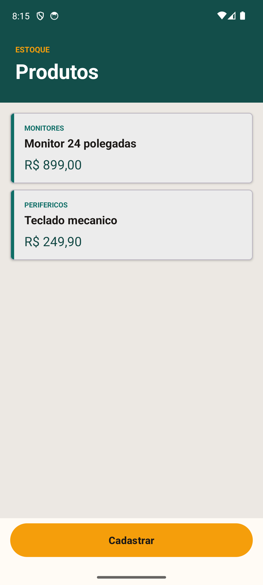
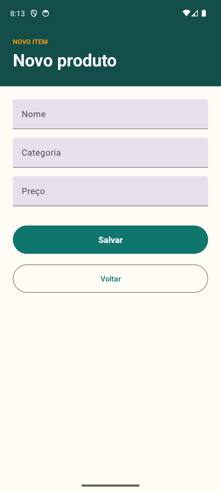
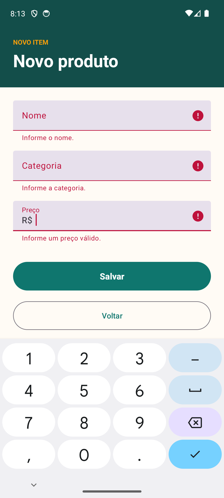
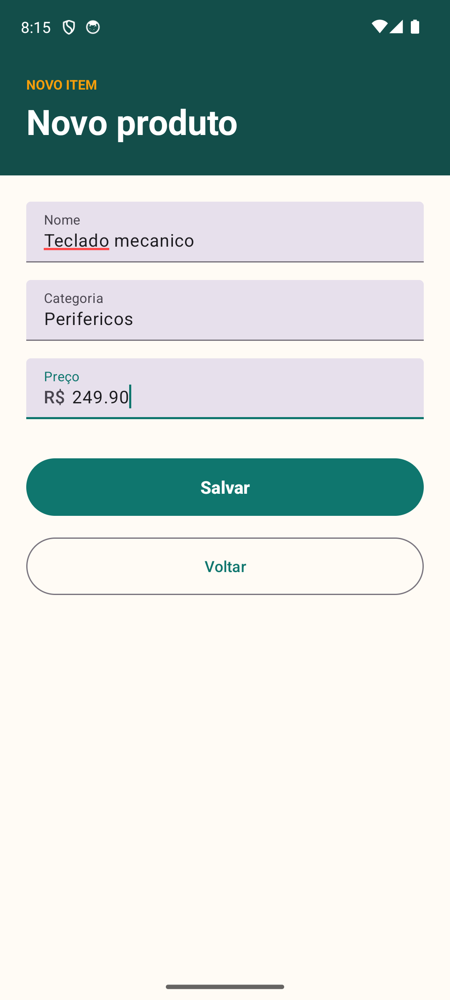

# TP08 - Firestore: cadastro e listagem de produtos

**Participantes:**

- Yasmin dos Santos Batista - RA: 241959
- Victoria Antunes - RA: 239588

**Disciplina:** Desenvolvimento para Dispositivos Móveis
**Professor(a):** ALESSANDRO FERREIRA PAZ DE LIMA

## Sobre o projeto

Aplicativo Android em Kotlin que usa o Cloud Firestore.

- **Lista de produtos** (primeira tela): recupera todos os documentos da coleção `Produtos` e exibe em uma lista.
- **Cadastro de produto**: formulário com nome, categoria e preço; grava um novo documento com ID autogerado.

Estrutura no Firestore:

```
Produtos (coleção)
└── <id autogerado> (documento)
    ├── nome: string
    ├── categoria: string
    └── preco: number
```

## Prints

| Lista de produtos                    | Cadastro                               |
| ------------------------------------ | -------------------------------------- |
|    |  |

| Cadastro com erro de validação                  | Cadastro preenchido                                   |
| ----------------------------------------------- | ----------------------------------------------------- |
|        |  |

## Como rodar

1. Use o mesmo projeto do [Console do Firebase](https://console.firebase.google.com) do TP07, cujo app Android
   tem o pacote `com.example.tp07_authfirebase` (é o `applicationId` deste projeto, para reaproveitar o `google-services.json`).
2. Em **Firestore Database**, crie o banco e, em **Regras**, libere leitura e escrita
   (`allow read, write: if true;`, apenas para o trabalho).
3. Coloque o `google-services.json` em `app/google-services.json`
   (arquivo no `.gitignore`; há um modelo em `app/google-services.json.example`).
4. Abra no Android Studio e execute.

> Como o `applicationId` é o mesmo do TP07, instalar este app substitui o do TP07 no dispositivo.

## Estrutura

- `model/Product.kt`: modelo e nomes da coleção/campos.
- `view/ProductListActivity.kt` e `ProductAdapter.kt`: tela de listagem.
- `view/RegisterProductActivity.kt`: tela de cadastro.
